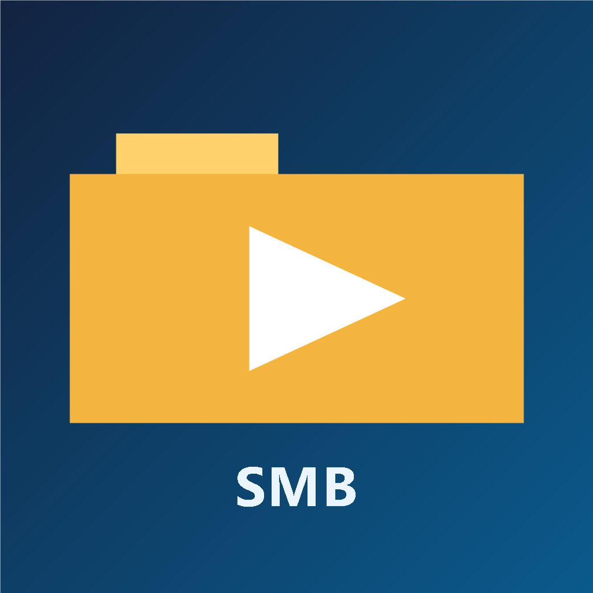

<div align="center">



# SMB Media Viewer

**Navegue, assista e organize fotos e vídeos direto do seu compartilhamento de rede (SMB) — sem baixar nada antes.**


[](https://github.com/batatinhafcbatatinha-pixel/SMB-UI/actions/workflows/android.yml)


</div>

---

## Recursos

| | |
|---|---|
| **Navegação SMB nativa** | Lista compartilhamentos e pastas via [SMBJ](https://github.com/hierynomus/smbj) no lado Android, com cache e atualização incremental. |
| **Streaming de vídeo** | Proxy HTTP local que lê o arquivo em blocos do servidor e entrega ao player (VLC) com suporte a *seek*, sem baixar o vídeo inteiro. |
| **Miniaturas rápidas** | Geração paralela de thumbnails de imagens e vídeos, com cache em memória e em disco. |
| **Busca e filtros** | Busca por nome tolerante a acentos, filtros por tipo e ordenação por nome, data ou tamanho — lembrados por pasta. |
| **Edição leve** | Recorte de imagens e corte de vídeos, salvando como cópia ou substituindo o original no servidor. |
| **Gerenciamento de arquivos** | Seleção múltipla para copiar, mover, excluir e enviar arquivos. |
| **Gestos** | Zoom, arrastar e deslizar entre mídias no visualizador. |
| **Idiomas** | Interface em português e inglês. |

## Arquitetura

```
┌──────────────────────────── Flutter (Dart) ────────────────────────────┐
│  main.dart ─ telas (servidores, pastas, visualizador)                  │
│  utils/smb_client.dart ───────────┐                                    │
│  utils/parallel_thumbnail_loader  │ MethodChannel                      │
│  utils/smb_video_proxy_server ────┼──► http://127.0.0.1 ──► VLC player │
└───────────────────────────────────┼────────────────────────────────────┘
                                    ▼
┌──────────────────────── Android (Kotlin) ──────────────────────────────┐
│  MainActivity.kt ─ listShares · listDirectory · readSmbFileChunk ·     │
│                    generateThumbnail · copy/move/upload/deleteFile     │
│                                  │                                     │
│                                  ▼  SMBJ                               │
└──────────────────────────────────┼─────────────────────────────────────┘
                                   ▼
                          Servidor SMB (Windows / Samba / NAS)
```

## Download

Baixe o APK mais recente em [Releases](https://github.com/batatinhafcbatatinha-pixel/SMB-UI/releases/latest). Builds de cada commit ficam disponíveis como artefato na aba [Actions](https://github.com/batatinhafcbatatinha-pixel/SMB-UI/actions/workflows/android.yml).

## Começando

### Pré-requisitos

- [Flutter](https://docs.flutter.dev/get-started/install) **3.35+** (Dart 3.9+)
- Android SDK e um dispositivo ou emulador Android
- Um compartilhamento SMB acessível na mesma rede

### Rodando

```bash
git clone https://github.com/batatinhafcbatatinha-pixel/SMB-UI.git
cd SMB-UI
flutter pub get
flutter run
```

No Windows também há atalhos que detectam o dispositivo automaticamente:

```powershell
./run_android.ps1      # ou run_android.bat
```

### Gerando o APK

```bash
flutter build apk --release
```

## Testes

```bash
flutter test
```

Os testes cobrem navegação e atualização de pastas, busca, filtros em pastas grandes, preferências de visualização, cache em memória, leitura de duração de MP4, o proxy de vídeo e os gestos do visualizador.

## Estrutura

```
lib/
├── main.dart                  # App, telas e visualizador de mídia
├── image_editor.dart          # Recorte de imagens
├── video_trimmer_screen.dart  # Corte de vídeos
├── utils/                     # Cliente SMB, caches, thumbnails, proxy de vídeo
└── widgets/                   # Viewport de vídeo e gestos
android/                       # Plugin SMB nativo (Kotlin + SMBJ)
test/                          # Testes de widget e unidade
tool/                          # Benchmark SMB e runner com logs
```
