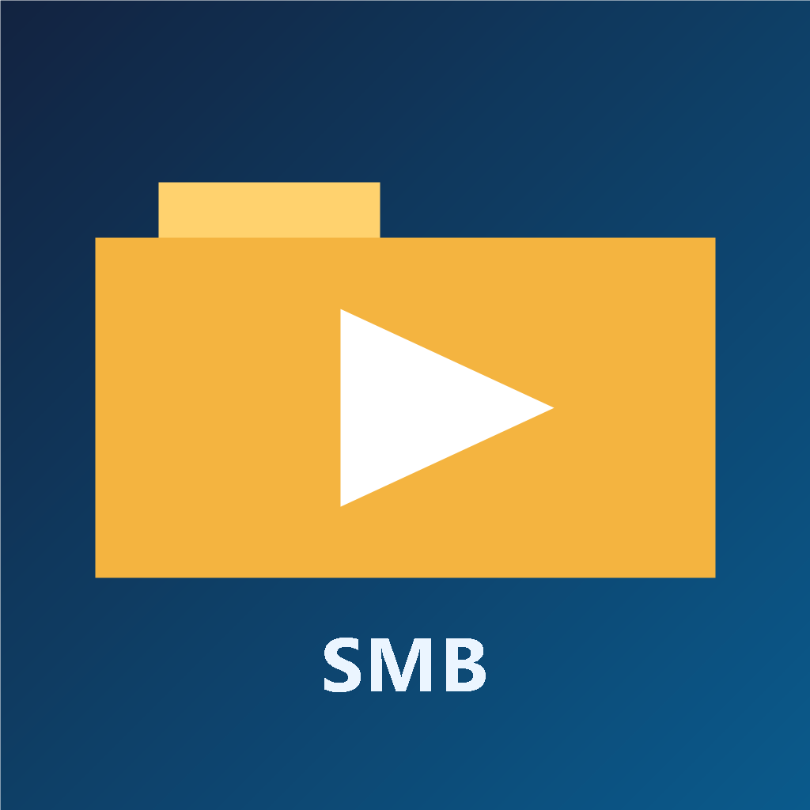

<div align="center">



# SMB Media Viewer

**Browse, watch, and organize photos and videos straight from your network share (SMB) — without downloading anything first.**


[](https://github.com/batatinhafcbatatinha-pixel/SMB-UI/actions/workflows/android.yml)


</div>

---

## Features

| | |
|---|---|
| **Native SMB browsing** | Lists shares and folders through [SMBJ](https://github.com/hierynomus/smbj) on the Android side, with caching and incremental refresh. |
| **Video streaming** | A local HTTP proxy reads the file in chunks from the server and feeds it to the player (VLC) with seek support, without downloading the whole video. |
| **Fast thumbnails** | Parallel thumbnail generation for images and videos, with in-memory and on-disk caches. |
| **Search and filters** | Accent-insensitive name search, type filters, and sorting by name, date, or size — remembered per folder. |
| **Light editing** | Crop images and trim videos, saving as a copy or replacing the original on the server. |
| **File management** | Multi-select to copy, move, delete, and upload files. |
| **Gestures** | Zoom, pan, and swipe between media in the viewer. |
| **Languages** | Interface in Portuguese and English. |

## Architecture

```
┌──────────────────────────── Flutter (Dart) ────────────────────────────┐
│  main.dart ─ screens (servers, folders, viewer)                        │
│  utils/smb_client.dart ───────────┐                                    │
│  utils/parallel_thumbnail_loader  │ MethodChannel                      │
│  utils/smb_video_proxy_server ────┼──► http://127.0.0.1 ──► VLC player │
└───────────────────────────────────┼────────────────────────────────────┘
                                    ▼
┌──────────────────────── Android (Kotlin) ──────────────────────────────┐
│  MainActivity.kt ─ listShares · listDirectory · readSmbFileChunk ·     │
│                    generateThumbnail · copy/move/upload/deleteFile     │
│                                  │                                     │
│                                  ▼  SMBJ                               │
└──────────────────────────────────┼─────────────────────────────────────┘
                                   ▼
                          SMB server (Windows / Samba / NAS)
```

## Download

Get the latest APK from [Releases](https://github.com/batatinhafcbatatinha-pixel/SMB-UI/releases/latest). Builds for every commit are available as artifacts in the [Actions](https://github.com/batatinhafcbatatinha-pixel/SMB-UI/actions/workflows/android.yml) tab.

## Getting started

### Prerequisites

- [Flutter](https://docs.flutter.dev/get-started/install) **3.35+** (Dart 3.9+)
- Android SDK and an Android device or emulator
- An SMB share reachable on the same network

### Running

```bash
git clone https://github.com/batatinhafcbatatinha-pixel/SMB-UI.git
cd SMB-UI
flutter pub get
flutter run
```

On Windows there are also shortcuts that detect the device automatically:

```powershell
./run_android.ps1      # or run_android.bat
```

### Building the APK

```bash
flutter build apk --release
```

## Tests

```bash
flutter test
```

The tests cover folder navigation and refresh, search, filters in large folders, view preferences, the in-memory cache, MP4 duration parsing, the video proxy, and the viewer gestures.

## Project structure

```
lib/
├── main.dart                  # App, screens, and media viewer
├── image_editor.dart          # Image cropping
├── video_trimmer_screen.dart  # Video trimming
├── utils/                     # SMB client, caches, thumbnails, video proxy
└── widgets/                   # Video viewport and gestures
android/                       # Native SMB plugin (Kotlin + SMBJ)
test/                          # Widget and unit tests
tool/                          # SMB benchmark and log-capturing runner
```
